# Выявление и замена англицизмов в русскоязычных новостях

Магистерская работа «Применение методов машинного обучения для выявления англицизмов в русскоязычных новостных статьях». Финансовый университет при Правительстве РФ, факультет информационных технологий и анализа больших данных, 2025. Текст работы лежит в [`ГордееваНГ_ВКР.pdf`](ГордееваНГ_ВКР.pdf).

Система из трех этапов находит англицизмы в предложении и переписывает его русскими аналогами, сохраняя грамматику и смысл. На детекции XGBoost дает F1 0,9949 и ROC-AUC 0,999 на 10 000 тестовых слов. На замене дообученный Qwen2.5-1.5B-Instruct дает BLEU 0,807 против 0,595 у ruGPT-3 Large и 0,588 у TinyLlama. Гибридная модель целиком дает BLEU 0,805 на новостях против 0,32 у словарной замены.

## Модели на Hugging Face

| Модель | Роль | BLEU |
|---|---|---|
| [anglicism-rewriter-qwen2.5-1.5b-lora](https://huggingface.co/nata2627/anglicism-rewriter-qwen2.5-1.5b-lora) | основная, этап III гибридной модели | **0,807** |
| [anglicism-rewriter-rugpt3large-lora](https://huggingface.co/nata2627/anglicism-rewriter-rugpt3large-lora) | сравнение | 0,595 |
| [anglicism-rewriter-tinyllama-1.1b-lora](https://huggingface.co/nata2627/anglicism-rewriter-tinyllama-1.1b-lora) | сравнение | 0,588 |

В карточках описаны параметры обучения, формат промпта и код загрузки.

## Архитектура

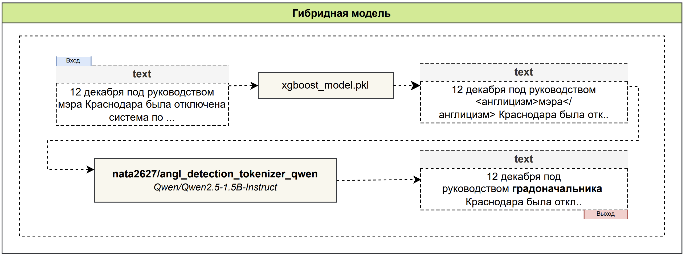

На вход подается предложение. XGBoost размечает англицизмы тегами `<англицизм>`, дообученная Qwen переписывает предложение целиком. На схемах встречается прежнее имя репозитория модели `angl_detection_tokenizer_qwen`, Hugging Face перенаправляет его на новое.

### Этап I. Классификация слов

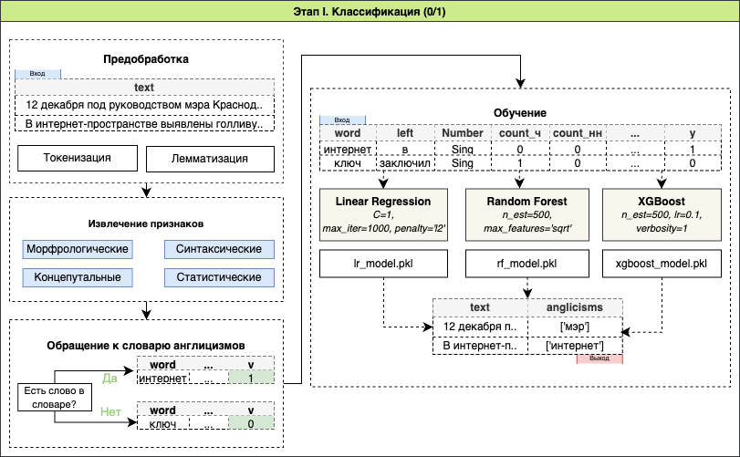

Словарный поиск находит только 65% англицизмов (recall 0,65). Он не узнает новые слова и формы, которых нет в списке, поэтому задача поставлена как бинарная классификация слова. У каждого слова около 4800 признаков. Среди них морфология слова и его соседей (по два слева и справа), длина, регистр, частоты букв и сдвоенных букв, эмбеддинги RuBERT для слова, леммы и контекста.

Сравнение на выборке из 20 000 слов (18 000 для обучения, 2 000 для теста).

| Метрика | Logistic Regression | Random Forest | XGBoost |
|---|---|---|---|
| Accuracy | 0,9465 | 0,9775 | **0,9885** |
| Precision | 0,9408 | **0,9948** | 0,9929 |
| Recall | 0,9530 | 0,9600 | **0,9840** |
| F1 | 0,9468 | 0,9771 | **0,9884** |

Лучшая модель, XGBoost, переобучена на 100 000 слов (90 000 для обучения, 10 000 для теста).

| Метрика | XGBoost, 20k | XGBoost, 100k | Прирост |
|---|---|---|---|
| Accuracy | 0,9885 | 0,9949 | +0,0064 |
| Precision | 0,9929 | 0,9938 | +0,0009 |
| Recall | 0,9840 | 0,9960 | +0,0120 |
| F1 | 0,9884 | 0,9949 | +0,0065 |

<p>
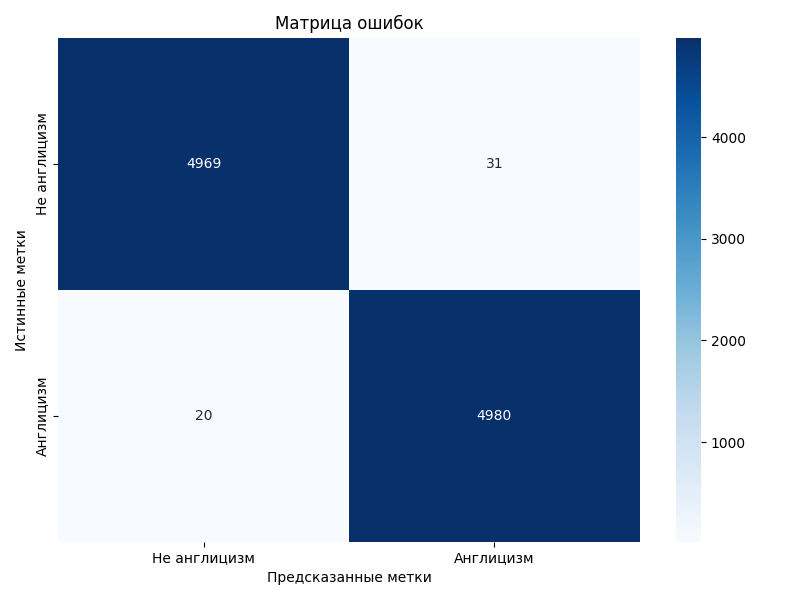
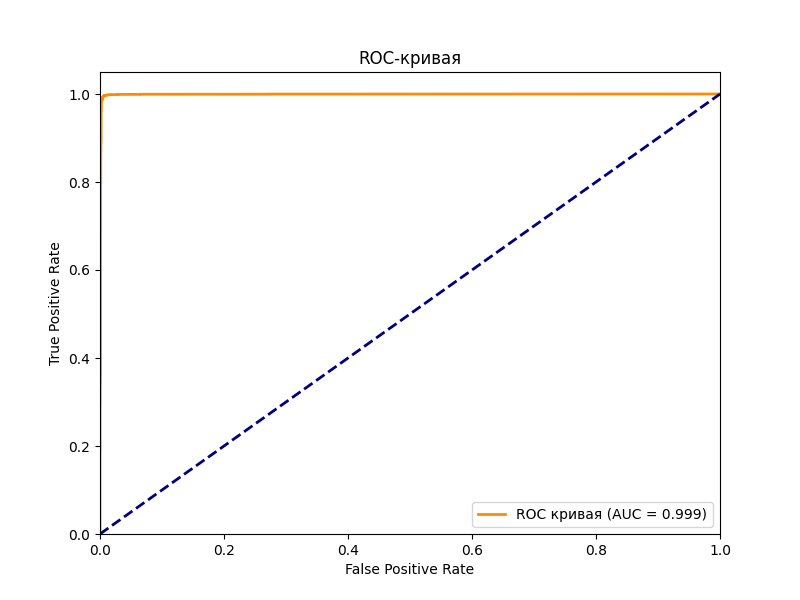
</p>

Из 10 000 тестовых слов модель ошиблась на 51, это 31 ложное срабатывание и 20 пропусков.

### Этап II. Эталонные предложения

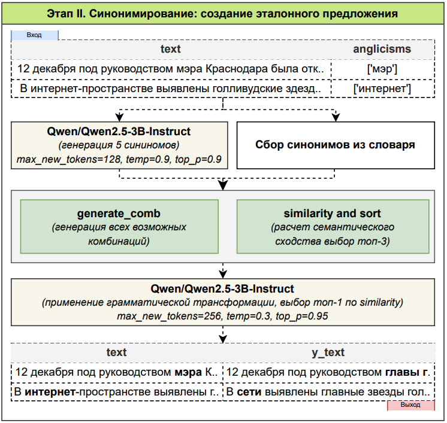

Для каждого англицизма Qwen2.5-3B-Instruct предлагает пять синонимов, к ним добавляются синонимы из словаря. Все комбинации замен ранжируются по семантической близости к исходному предложению, а лучшую Qwen приводит в грамматически верную форму. Размер модели выбран по качеству и скорости.

| Параметров | Средняя семантическая близость, % | Секунд на предложение |
|---|---|---|
| 0.5B | 92,4 | 14 |
| 1.5B | 94,8 | 11 |
| **3B** | **97,8** | **12** |
| 7B | 98,2 | 38 |
| 14B | 98,3 | 124 |

3B почти не уступает 7B и 14B по близости, а работает в 3 и в 10 раз быстрее.

Пример. На входе «Поводов для эвакуации жителей Харькова пока нет, заявил Игорь Терехов в интервью украинскому изданию LIGA» с англицизмом «интервью». Лучшие замены «беседа», «разговор», «дискуссия». Лучшее предложение «...заявил Игорь Терехов в беседе с украинским изданием LIGA», близость 0,995.

### Этап III. Дообучение LLM

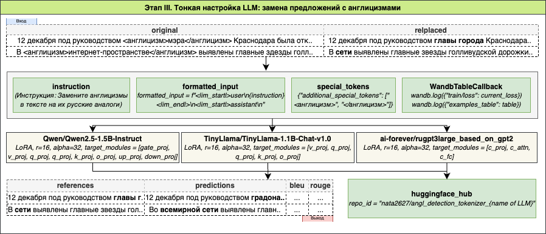

Три модели дообучены методом LoRA (r = 16, alpha = 32) на 18 480 парах «исходное предложение, эталон», еще 2 310 пар ушли на валидацию и 2 310 на тест. В токенизатор добавлены теги `<англицизм>` и `</англицизм>`, обучение логировалось в Weights & Biases.

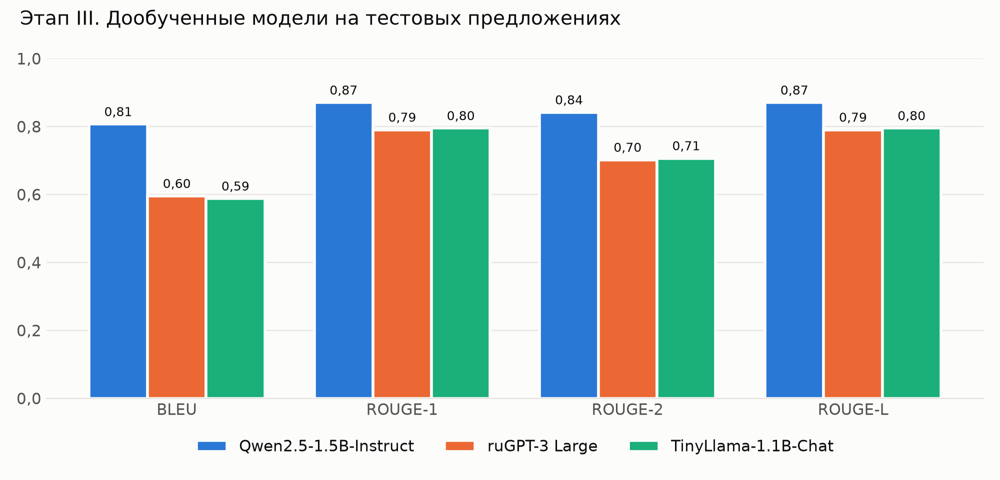

| Модель | Время обучения | Примеров в секунду |
|---|---|---|
| ruGPT-3 Large | 3 ч 25 мин | 4,50 |
| TinyLlama-1.1B-Chat | 3 ч 26 мин | 4,47 |
| Qwen2.5-1.5B-Instruct | 6 ч 26 мин | 2,20 |

Qwen учится вдвое дольше, но выигрывает по всем метрикам. Средняя длина ее ответа 17,0 слова при 17,9 у эталона, у ruGPT 19,4, у TinyLlama 22,6.

## Качество гибридной модели

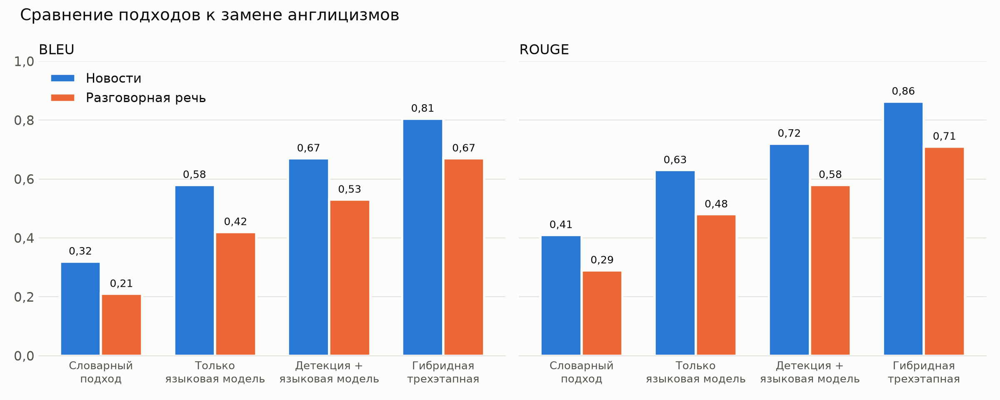

Итоговая проверка проводилась на новостных предложениях и на разговорных фразах. Разговорная речь для модели новый тип текста, в обучении ее не было. Каждый этап добавляет качество, и полная схема лучше всех вариантов без какого-либо из этапов.

| Исходное | Этап I | Этап II | Этап III |
|---|---|---|---|
| На пресс-конференции топ-менеджер презентовал дорожную карту развития компании, подчеркнув важность инноваций. | пресс-конференции, топ-менеджер, карту, компании, инновации | На встрече с представителями руководитель высшего звена представил план развития предприятия, подчеркнув важность передовых разработок | На мероприятии для представителей руководитель продемонстрировал план развития компании, подчеркнув важность новаторских разработок. |
| Скинь мне лук твоего аутфита для вечеринки. | скинь, лук, аутфита | Отправь мне изображение твоего наряда для вечеринки. | Отправь мне снимок твоей одежды для вечеринки. |

## Данные

**Словарь.** 18 784 англицизма из [словаря англицизмов А. И. Дьякова](http://anglicismdictionary.ru/), очищенного и дополненного русскими синонимами (от двух до пяти на слово).

<p>
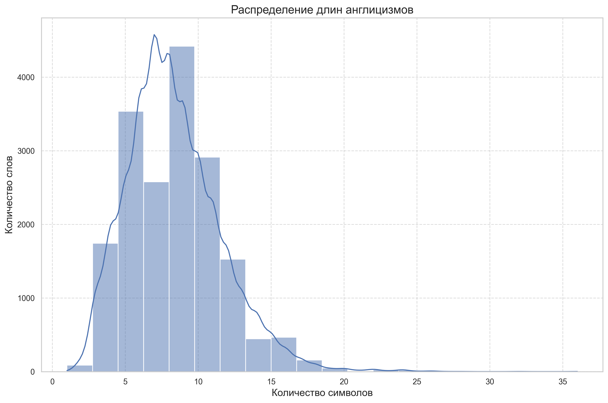
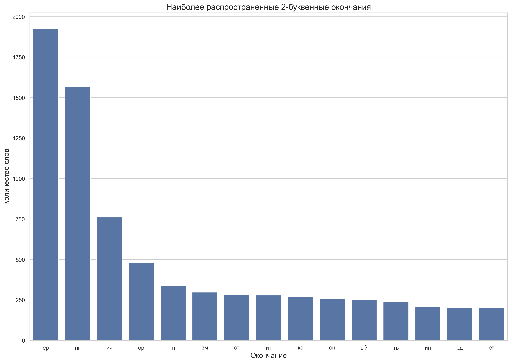
</p>
<p>
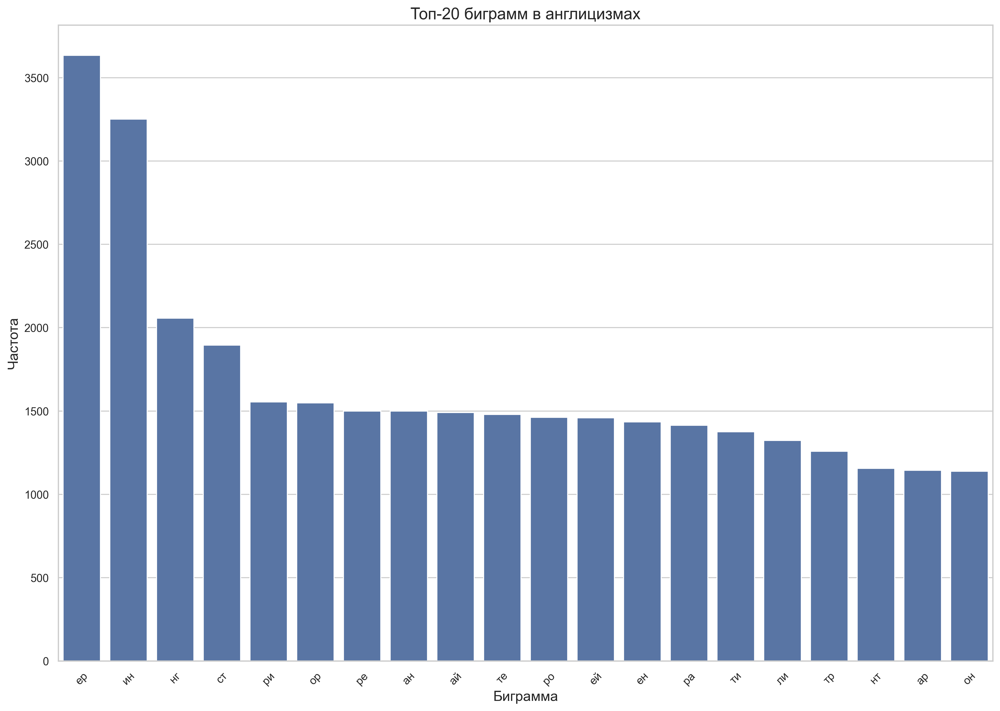
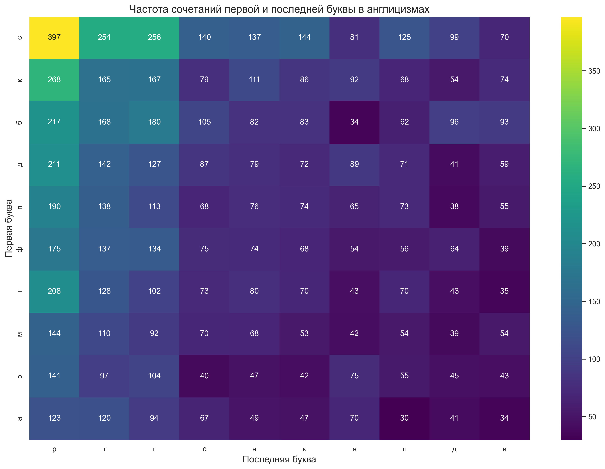
</p>

Медианная длина англицизма 8 символов. Чаще всего они кончаются на «-ер» и «-нг», а самые частые биграммы «ер», «ин» и «нг». Эти закономерности вошли в символьные признаки этапа I.

**Корпус.** 50 763 новостные статьи РБК с 01.04.2024 по 01.04.2025. Статьи очищены и разбиты на предложения. Слово считается англицизмом, если его лемма есть в словаре, оно не входит в стоп-слова и список исключений и не стоит в кавычках, потому что в кавычках обычно названия и имена собственные.

Данные в репозиторий не выкладываются. Условия использования РБК не разрешают распространять тексты сайта.

## Структура репозитория

| Папка | Что делает |
|---|---|
| `parse_anglicism/` | парсинг и анализ словаря англицизмов |
| `parse_dataset/`, `clear_dataset/` | сбор и очистка новостей |
| `label_data/`, `label_ML_data/` | разметка корпуса |
| `create_classicML_dataset/`, `classic_ML_models/` | признаки и модели этапа I |
| `create_ethalon/` | эталонные предложения этапа II |
| `create_LLM_dataset/`, `train/`, `base_model/` | данные и дообучение LLM этапа III |
| `LLM_results/` | ноутбуки с тестированием Qwen, ruGPT и TinyLlama |
| `llm_inference/` | применение обученной модели |
| `configs/` | конфигурации Hydra |

## Запуск

```bash
pip install -r requirements.txt

python parse_anglicism/main.py           # словарь
python parse_dataset/main.py             # новости
python clear_dataset/main.py
python label_data/main.py                # разметка
python create_classicML_dataset/main.py
python classic_ML_models/train_xgboost_model.py
python create_ethalon/main.py            # эталоны
python create_LLM_dataset/main.py
python train/qwen.py                     # дообучение
python llm_inference/main.py
```

Обучение LLM выполнялось на GPU в Kaggle, пути к данным в `train/qwen.py` указаны в формате Kaggle. Зависимости в `requirements.txt` собраны под CUDA 12.6.

## Ограничения

- Корпус РБК неравномерен по рубрикам, политики в нем больше, чем технологий и бизнеса, где англицизмов больше всего.
- Языковая модель иногда придумывает несуществующие слова. Пример есть в таблице 3.2.1 текста работы.
- Итоговая проверка гибридной модели проведена на небольшом наборе предложений, поэтому ее метрики заметно шумят.

## Автор

Гордеева Наталия Георгиевна · gordeevanatalia04@gmail.com · Telegram [@daisy_nata](https://t.me/daisy_nata)
